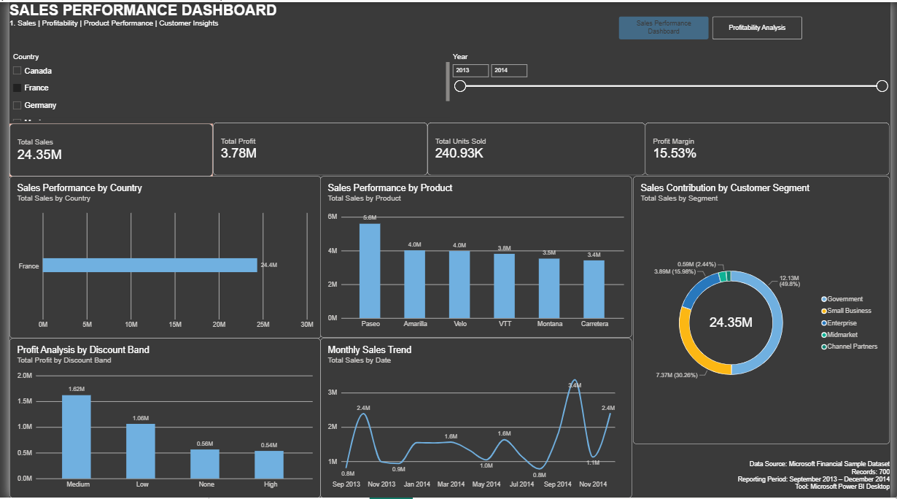
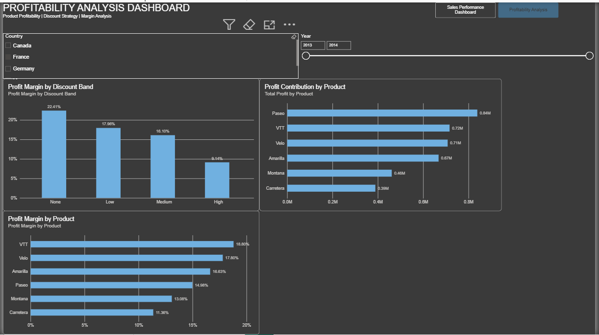

# Sales Performance Analysis Using Power BI

## Project Overview

This project analyses sales and profitability data using Microsoft Power BI. The objective is to identify sales trends, product performance, customer segment contributions, and profitability patterns to support business decision-making.

## Dataset Information

- **Dataset:** Microsoft Financial Sample
- **Source:** Microsoft sample dataset
- **Total Records:** 700
- **Total Columns:** 16
- **Reporting Period:** September 2013 – December 2014

This is a sample dataset used for learning and analytical practice. The findings should not be interpreted as current market performance.

## Tools and Technologies

- Microsoft Power BI Desktop
- Power Query
- DAX (Data Analysis Expressions)
- Microsoft Excel

## Data Preparation

The dataset was imported from Excel and inspected using Power Query.

Data preparation activities included:
- Checking column quality.
- Checking for missing values and errors.
- Verifying column data types.
- Standardising the Sales column name.
- Renaming the query to SalesData.

The initial data-quality inspection showed 700 rows, with no missing values or errors.

## Key Performance Indicators (KPIs)

| KPI | Result |
|---|---:|
| Total Sales | 118.73 Million |
| Total Profit | 16.89 Million |
| Total Units Sold | 1.13 Million |
| Profit Margin | 14.23% |

## Dashboard Pages

### Page 1: Sales Performance Dashboard

Visualisations include:
- Sales Performance by Country
- Sales Performance by Product
- Sales Contribution by Customer Segment
- Monthly Sales Trend
- Profit Analysis by Discount Band

### Page 2: Profitability Analysis

Visualisations include:
- Profit Margin by Discount Band
- Profit Contribution by Product
- Profit Margin by Product

## Dashboard Screenshots

### Sales Performance Dashboard

### Profitability Analysis

## Key Business Insights

### 1. Geographical Performance
- USA generates the highest sales, at approximately 25 million.
- Mexico generates the lowest sales among the countries analysed.

### 2. Product Performance
- Paseo generates the highest sales and total profit.
- Carretera generates the lowest sales and total profit.

### 3. Customer Segment Performance
- Government contributes the highest sales.
- Channel Partners contribute the lowest sales.

### 4. Monthly Sales Trends
- September 2013 recorded the lowest sales.
- September to November 2014 represented a strong sales period.

### 5. Discount Strategy
- Low Discount generates the highest total profit.
- No Discount generates the lowest total profit.
- No Discount has the highest profit margin.
- High Discount has the lowest profit margin.

This demonstrates why total profit and profit margin should be evaluated separately.

### 6. Product Profitability
- Paseo generates the highest total profit.
- Amarilla has the highest profit margin.
- Velo has the lowest profit margin.

## Business Recommendations

- Study the factors contributing to strong sales in the USA.
- Investigate product demand and pricing opportunities in Mexico.
- Analyse Paseo's successful sales and profitability performance.
- Investigate opportunities to improve Channel Partner performance.
- Review the discount strategy to balance sales volume and profit margin.
- Investigate the cost and pricing structure of products with lower profit margins.

## Interactive Features

- Country slicer
- Year slicer
- Slicers synchronised across both report pages
- Interactive charts
- Page navigation buttons

## Project Outcome

This project provided practical experience in data preparation, Power Query, DAX measures, KPI creation, data visualisation, interactive dashboard development, and business insight generation.

## Dashboard Previews

### 1. Sales Performance Dashboard

### 2. Profitability Analysis

